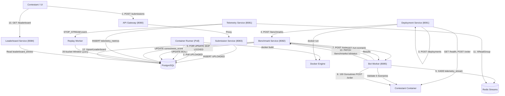

# BenchForge Phase 2 Audit — Benchmark Lifecycle Correctness

**Workstream A: End-to-End Lifecycle and State Machine Audit**

---

## 1. End-to-End Architecture & Lifecycle Overview

The BenchForge benchmark execution pipeline traverses multiple decoupled microservices interacting through synchronous HTTP REST calls, asynchronous polling, PostgreSQL row updates, and Redis Streams.

---

## 2. Comprehensive Lifecycle Transition Table

| Current State | Trigger / Event | Preconditions | Side Effects / Operations | Next State | Failure Behavior | Code Evidence |
|---|---|---|---|---|---|---|
| **INIT** | Contestant calls `POST /submissions` with multipart ZIP | Valid JWT token, non-empty `submissionName`, `language` in (`go`,`cpp`,`rust`) | Writes ZIP to disk; inserts row into `submissions` | `UPLOADED` | Returns 400 Bad Request; no DB record created | [`submissions.go:76-130`](file:///e:/AIML_Projects/iicpc_benchforge/services/submission-service/internal/handlers/submissions.go#L76-L130) |
| **UPLOADED** | `container-runner` 5s poll ticker detects `status='UPLOADED'` | Submission exists in DB | Unzips file to `/tmp/build-*`; writes Dockerfile; runs `docker build` | `BUILDING` $\to$ `BUILT` | Updates `status='FAILED'`, logs build error in `submission_logs` | [`runner.go:44-120`](file:///e:/AIML_Projects/iicpc_benchforge/services/container-runner/internal/runner/runner.go#L44-L120) |
| **BUILT** | User or automated pipeline calls `POST /deployments` | Submission status is `BUILT` and image exists | Scans DB for free host port (30000–31000); runs `docker run` on shared network | `DEPLOYING` $\to$ `RUNNING` | Updates deployment to `FAILED`; fails submission pipeline stage | [`deployments.go:170-204`](file:///e:/AIML_Projects/iicpc_benchforge/services/deployment-service/internal/handlers/deployments.go#L170-L204) |
| **RUNNING (Deployment)** | Deployment successful | Container is running and port is listening | Pings `GET /health` and `POST /order` dummy order | `VALIDATION (SUCCESS)` | If health or order fails: records in `validation_results`, stops container | [`deployments.go:240-272`](file:///e:/AIML_Projects/iicpc_benchforge/services/deployment-service/internal/handlers/deployments.go#L240-L272) |
| **VALIDATION (SUCCESS)** | Automated trigger after deployment validation | Deployment is `RUNNING` | Sends `POST /benchmarks` to `benchmark-service` | `QUEUED` | Benchmark service returns error; submission marked `FAILED` | [`deployments.go:281-324`](file:///e:/AIML_Projects/iicpc_benchforge/services/deployment-service/internal/handlers/deployments.go#L281-L324) |
| **QUEUED** | Benchmark queue worker runs `ProcessQueue()` | No other benchmark currently `RUNNING` (`CountRunning < 1`) | Queries next benchmark via `FOR UPDATE SKIP LOCKED`; marks `status='RUNNING'` | `RUNNING` | If `CountRunning >= 1`, worker exits and leaves benchmark in queue | [`benchmarks.go:100-130`](file:///e:/AIML_Projects/iicpc_benchforge/services/benchmark-service/internal/handlers/benchmarks.go#L100-L130) |
| **RUNNING (Pre-Validation)** | Benchmark starts execution | Target URL resolved | POST 6 static scenarios to `bot-worker:8085/run-scenario` | `CORRECTNESS_VALIDATED` | If scenarios fail or engine returns legacy: `correctness_score` remains 0.0 or NULL | [`benchmarks.go:260-334`](file:///e:/AIML_Projects/iicpc_benchforge/services/benchmark-service/internal/handlers/benchmarks.go#L260-L334) |
| **CORRECTNESS_VALIDATED** | Scenario validation complete | Scenario HTTP call returned 200 OK | Generates worker JWT; sends `POST /run` to `bot-worker:8085` | `LOAD_TESTING` | If bot-worker fails to start, benchmark hangs until watchdog times out | [`benchmarks.go:341-395`](file:///e:/AIML_Projects/iicpc_benchforge/services/benchmark-service/internal/handlers/benchmarks.go#L341-L395) |
| **LOAD_TESTING** | `bot-worker` spawns 100 goroutines | Warm-up phase completes | Dispatches `totalRequests` orders; 5% tracer, 95% personas; streams metrics to Redis | `TEST_COMPLETING` | If engine crashes, requests fail (logged as 5000ms latency); if worker crashes, watchdog fires | [`main.go:249-315`](file:///e:/AIML_Projects/iicpc_benchforge/services/bot-worker/cmd/worker/main.go#L249-L315) |
| **TEST_COMPLETING** | All jobs consumed from channel | Results channel closed | Computes histogram P50/P90/P99; sends `PATCH /benchmarks/:id/status` with metrics | `COMPLETED` | If PATCH fails, status in DB remains `RUNNING` until watchdog intervenes | [`main.go:331-345`](file:///e:/AIML_Projects/iicpc_benchforge/services/bot-worker/cmd/worker/main.go#L331-L345) |
| **COMPLETED** | `benchmark-service` receives `PATCH status='COMPLETED'` | Status is `COMPLETED` and target is `deployment` | Upserts row into `leaderboard_entries` if correctness details exist; runs rank query | `PERSISTED` | If database error occurs during upsert, logged as error; next queue job still runs | [`benchmarks.go:577-597`](file:///e:/AIML_Projects/iicpc_benchforge/services/benchmark-service/internal/handlers/benchmarks.go#L577-L597) |
| **PERSISTED** | Bot Worker publishes `STOP_STREAM` control metric | Telemetry consumer receives control message | Writes `PENDING` to `benchmark_replays`; invokes `GenerateReplay()` window query | `REPLAY_READY` | If replay aggregation fails, marks replay `FAILED`; does not affect leaderboard | [`consumer.go:352-365`](file:///e:/AIML_Projects/iicpc_benchforge/services/telemetry-service/internal/consumer/consumer.go#L352-L365) |

---

## 3. The 10 In-Depth Lifecycle Questions

### 1. What input is received?
- **At Submission:** A multipart HTTP request containing `submissionName`, `teamName`, `language`, and the raw ZIP archive.
- **At Benchmark Creation:** JSON payload: `name`, `targetType` (`"mock"` or `"deployment"`), `submissionId`, `deploymentId`, `workerCount` (default: 100), `totalRequests` (default: 1000).
- **At Bot Worker `/run`:** JSON payload containing `benchmarkId`, `targetUrl`, `workerCount`, `totalRequests`, `submissionId`, `token` (HMAC-SHA256 JWT), `traceId`, `traceContext`, and `seed`.

### 2. What validation occurs?
- **Submission:** Checks that fields are non-empty and language is in `[go, cpp, rust]`. **Defect:** No validation against zip-slip directory traversal (BF-P1-002).
- **Deployment:** Pings `GET /health` (expects 200) and `POST /order` (expects 2xx). **Defect:** Ignores response body entirely; empty or corrupt JSON passes deployment validation.
- **Scenario Validation:** Runs 6 hardcoded scenarios against `POST /order`. Validates status string and trade receipts against hardcoded expectations. **Defect:** Never validates `executed_quantity` field; susceptible to canned response gaming.
- **Load Testing (`bot-worker`):** **Defect:** `checkCorrectnessStub` returns `true` for any HTTP 2xx response. Response body is not parsed or validated.

### 3. What state is persisted?
- In `submissions`: `status`, `container_image`, `build_logs`, `correctness_score`, `correctness_details`, `current_stage`, `stage_status`.
- In `deployments`: `container_id`, `container_image`, `host_port`, `deployment_status`, `deployment_logs`.
- In `benchmarks`: `status`, `total_requests`, `success_count`, `failure_count`, `p50`, `p90`, `p99`, `duration_seconds`, `execution_time_seconds`, `tracer_total`, `tracer_success`, `last_heartbeat`.
- In `telemetry_metrics`: `request_id`, `bot_type`, `worker_id`, `benchmark_id`, `latency` (in nanoseconds!), `success`, `created_at`.
- In `leaderboard_entries`: `normalized_team_name`, `tps`, `success_rate`, `p50`, `p90`, `p99`, `correctness_score`, `concurrency_score`, `final_score`, `rank`.

### 4. What operation is executed?
- Concurrent load generation: 100 goroutines consume `totalRequests` from an unbuffered channel and send HTTP POST requests over a bounded `http.Transport` connection pool (`MaxConnsPerHost = workerCount * 2`).
- Asynchronous stream ingestion: Redis `XReadGroup` reads messages, inserts into PostgreSQL, and ACKs only on success.
- Score computation: In-memory mathematical evaluation in `benchmark-service`, followed by an atomic `ON CONFLICT (normalized_team_name)` database upsert.

### 5. What output is produced?
- Real-time 1Hz WebSocket telemetry broadcasts (`TPS`, `P50`, `P90`, `P99`, per-worker, and per-persona breakdown).
- Final benchmark summary row in `benchmarks`.
- Updated row in `leaderboard_entries` with recalculated global ranks.
- 20-bucket aggregated JSON replay document in `benchmark_replays`.

### 6. What failure conditions are possible?
- **Pre-validation network timeout:** If `bot-worker` takes $>30\text{s}$ or is unreachable during `/run-scenario`, pre-validation fails, logging an error, but the benchmark **proceeds anyway** to load testing!
- **Container crash under load:** If the target engine crashes, all subsequent requests return connection errors or 5xx, resulting in 5000ms latency penalties.
- **Bot Worker crash:** If `bot-worker` dies mid-run, no PATCH is sent. The watchdog in `benchmark-service` detects missed heartbeats ($>60\text{s}$) and marks the benchmark `FAILED`.
- **Redis connection failure:** Consumer applies exponential backoff with jitter up to 1s. Unacknowledged messages are reclaimed after 5 minutes idle time.

### 7. What happens when the operation fails?
- If pre-validation fails due to network error, `correctness_score` is not set (`NULL`). When the benchmark completes, `leaderboard.go:112` **falls back to `computedSuccessRate`**, granting the crashed engine an inflated correctness score!
- If the benchmark fails or is cancelled, `UpdateBenchmarkStatus` triggers `go h.ProcessQueue()` to ensure the next queued benchmark is not permanently blocked.

### 8. Can a later step execute before its prerequisites are satisfied?
- **YES (Telemetry Ingestion Race Window):** When `bot-worker` finishes sending requests, it computes summary percentiles locally and immediately calls `PATCH /benchmarks/:id/status` with `COMPLETED`. This triggers `UpsertLeaderboardEntryFromBenchmark` instantly. However, Redis Streams may still have thousands of telemetry messages pending consumption in `telemetry_stream`. While the leaderboard reads from the `benchmarks` summary table (avoiding incomplete database row counts), the Replay Engine is triggered before all metrics are written, resulting in missing replay buckets or incomplete telemetry metrics in PostgreSQL.

### 9. Can the same step execute twice?
- **Container Build Duplicate Execution (BF-P1-013):** `container-runner` polls `submissions WHERE status='UPLOADED'` without `FOR UPDATE SKIP LOCKED`. Concurrent polls can trigger duplicate `docker build` processes for the same submission.
- **Port Allocation Race (BF-P1-014):** `AllocatePort` iterates 30000–31000 checking `isPortUsed` without a database lock, allowing concurrent deployments to assign the same host port.
- **Leaderboard Duplicate Protection:** Leaderboard upsert uses `ON CONFLICT (normalized_team_name) DO UPDATE ... WHERE EXCLUDED.final_score > leaderboard_entries.final_score`, ensuring idempotency and preserving personal bests.

### 10. What prevents an invalid or incomplete result from being published?
- Benchmarks targeting `mock` (`targetType == "mock"`) are explicitly filtered out from leaderboard upsert (`benchmarks.go:578`).
- Only benchmarks with status `COMPLETED` invoke `UpsertLeaderboardEntryFromBenchmark`.
- **Gaps:** An engine returning invalid responses that return HTTP 200 OK is NOT prevented from publishing. It receives a 100% success rate, a 100% fallback correctness score, and is published directly to the leaderboard.

---

## 4. Lifecycle Integrity Defects Summary

1. **Premature Finalization vs Telemetry Drainage:** Leaderboard entry is published before Redis Streams is fully drained.
2. **Failure Ignored in Pre-Validation:** Network failure during pre-validation does not halt the benchmark; the benchmark continues and scores with fallback correctness.
3. **Queue Lock Starvation:** Single concurrent benchmark limit (`CountRunning >= 1`) means any stalled benchmark blocks the entire competition until the 60s watchdog terminates it.
4. **Target URL Host Dependency:** Target container is addressed via Docker DNS as `http://deployment-{id}:{port}`. If Docker network resolution fails or container naming diverges, the benchmark attempts HTTP calls to a non-existent host.
