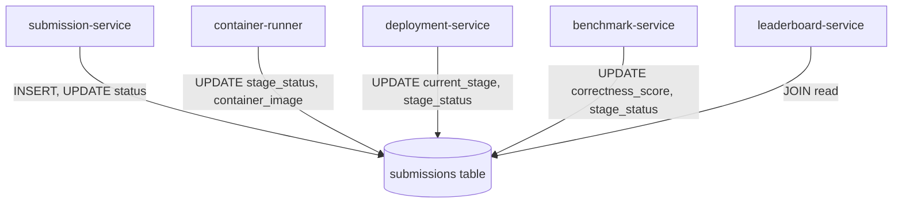

# BenchForge Phase 2 Audit — Persistence and Cross-Service Result Integrity

**Workstream G: Database Schema, Storage Precision, Multi-Service Writes, and Data Integrity**

---

## 1. Single Database Architecture & Distributed Anti-Patterns

BenchForge deploys a single shared PostgreSQL 16 database (`iicpc`) shared across all 9 microservices. Each service maintains its own directory of SQL migration files, but migrations are not coordinated by a centralized tool or runner (BF-P1-023).

### The Multi-Service Table Writer Anti-Pattern (BF-P1-032)
In standard microservice architectures, each table is owned and mutated by exactly one service. In BenchForge, the `submissions` table is concurrently mutated by **four distinct microservices** without centralized distributed locking:



### Race Conditions and Data Integrity Risks:
1. **Uncoordinated Pipeline Stage Updates:** `container-runner`, `deployment-service`, and `benchmark-service` all execute `UPDATE submissions SET current_stage=$1, stage_status=$2 WHERE id=$3` independently. If an asynchronous stage completion message arrives out of order, the submission's visual stage can regress from `BENCHMARK` back to `DEPLOYMENT`.
2. **Missing Row Locking in Container Runner (BF-P1-013):** `runner.go:44-59` executes `SELECT id FROM submissions WHERE status='UPLOADED'` without `FOR UPDATE SKIP LOCKED`. If multiple runner replicas run, or if a poll loop overlaps, the same submission is picked up twice and built concurrently.
3. **Port Allocation Race Condition (BF-P1-014):** In `deployer.go:63-82`, `AllocatePort` iterates from 30000 to 31000 querying `isPortUsed` without reserving the port row in a transaction. Two concurrent deployments can allocate the exact same host port, causing the second `docker run` to fail with "bind: address already in use."

---

## 2. Source of Truth Matrix

| Data Entity | Primary Source of Truth | Secondary / Derived Views | Consistency Mechanism | Integrity Risks |
|---|---|---|---|---|
| **Submission Metadata** | `submissions` table | `submission_logs` | Direct SQL UPDATE | Multi-service writer collisions |
| **Container & Port** | `deployments` table | Container runner output | Direct SQL INSERT/UPDATE | Port allocation race condition |
| **Benchmark Summary (P50, P90, P99)** | `benchmarks` table | Bot-worker logs | HTTP PATCH from `bot-worker` | In-memory histogram capped at 10,000ms |
| **Leaderboard Scores & Ranks** | `leaderboard_entries` table | Leaderboard API response | Triggered by `PATCH COMPLETED` on benchmark | Integer duration truncation; cheater gaming |
| **Raw Request Latencies** | `telemetry_metrics` table | Redis Streams `telemetry_stream` | Asynchronous worker consumption | Unbatched single-row SQL inserts |
| **Live Metric Broadcast** | In-memory `Aggregator` (`state.go`) | WebSocket broadcast (1Hz) | Ingested from Redis stream | Stored in nanoseconds; unconstrained memory |
| **Replay Timeline** | `benchmark_replays` table | Frontend Replay page | Window function query over `telemetry_metrics` | Hardcoded `count * 2` TPS; fabricated timestamps |

---

## 3. Schema Precision, Data Types, and Truncation Analysis

### A. The Integer Duration Truncation (`duration_seconds`)
- **Schema:** `duration_seconds INTEGER NOT NULL DEFAULT 0`, `execution_time_seconds INTEGER`.
- **Code:** `dur := int(duration.Int64)` in `leaderboard.go:99`.
- **Flaw:** High-performance trading engines processing small or medium benchmarks complete in fractional seconds. Storing duration as an integer truncates $0.8\text{s} \to 0$ (yielding 0 TPS) and $1.9\text{s} \to 1$ (yielding a 90% artificial TPS boost).
- **Remediation Required:** Alter column type to `NUMERIC(10, 4)` or `DOUBLE PRECISION` to preserve sub-millisecond duration fidelity.

### B. The Latency Unit Mismatch (`BIGINT` vs `NUMERIC`)
- **`telemetry_metrics.latency`:** Defined as `BIGINT`. Stores raw Go `time.Duration` nanoseconds (e.g., $15,000,000$).
- **`benchmarks.p99`:** Defined as `NUMERIC`. Stores milliseconds derived via `result.Latency.Seconds() * 1000` (e.g., $15.0$).
- **Impact:** Any query comparing raw telemetry against benchmark summaries requires explicit division by $1,000,000. Because this conversion is omitted in `replay_worker.go`, the Replay engine operates entirely on nanoseconds.

---

## 4. Asynchronous Write Race Windows

### The Telemetry Drainage Race Window
```
Bot Worker Loop Ends ──► Computes P50/P90/P99 ──► PATCH /benchmarks/:id (COMPLETED)
                                                         │
                                                         ▼
                                          UpsertLeaderboardEntryFromBenchmark
                                          (Reads benchmarks & submissions)
                                                         │
Redis Stream Backlog ──(Still draining...)──────► Database (telemetry_metrics)
```
- **Analysis:** When `bot-worker` completes its job loop, it immediately calls `PATCH /benchmarks/:id/status` with `COMPLETED`.
- `benchmark-service` immediately triggers `UpsertLeaderboardEntryFromBenchmark()`.
- **Integrity Assessment:** Fortunately, `UpsertLeaderboardEntryFromBenchmark()` reads summary metrics from `benchmarks` (which were sent directly by `bot-worker`), **not** from `telemetry_metrics`. Therefore, leaderboard calculation is protected from incomplete telemetry ingestion.
- **Vulnerability:** However, `STOP_STREAM` is published concurrently to Redis. If `telemetry-service` processes `STOP_STREAM` while messages are still in the stream buffer, `GenerateReplay()` executes its window query before all metrics have been inserted into `telemetry_metrics`, producing incomplete replay snapshots.

---

## 5. Leaderboard Upsert Idempotency Verification

Inspection of `services/benchmark-service/internal/repository/leaderboard.go:126-155`:

```sql
INSERT INTO leaderboard_entries (
  benchmark_id, team_name, normalized_team_name, submission_id,
  submission_name, deployment_id, tps, success_rate, p50, p90, p99,
  total_requests, duration_seconds, correctness_score, concurrency_score,
  final_score, created_at, updated_at
)
VALUES ($1, $2, LOWER(TRIM($2)), $3, $4, $5, $6, $7, $8, $9, $10, $11, $12, $13, $14, $15, now(), now())
ON CONFLICT (normalized_team_name) DO UPDATE SET
  benchmark_id = EXCLUDED.benchmark_id,
  ...
  final_score = EXCLUDED.final_score,
  updated_at = now()
WHERE EXCLUDED.final_score > leaderboard_entries.final_score;
```

### Verified Integrity Properties:
1. **Case-Insensitive Team Normalization:** `LOWER(TRIM($2))` prevents team name spoofing or duplicate entries via casing (e.g., `"Team Alpha"` vs `"team alpha"`).
2. **Monotonic Personal Best Preservation:** `WHERE EXCLUDED.final_score > leaderboard_entries.final_score` ensures that an accidental degraded run cannot lower an established team ranking.
3. **Contiguous Rank Maintenance:** Post-upsert `updateLeaderboardRanks` uses `ROW_NUMBER() OVER (...)` to atomically recalculate all integer ranks across the entire leaderboard table.
