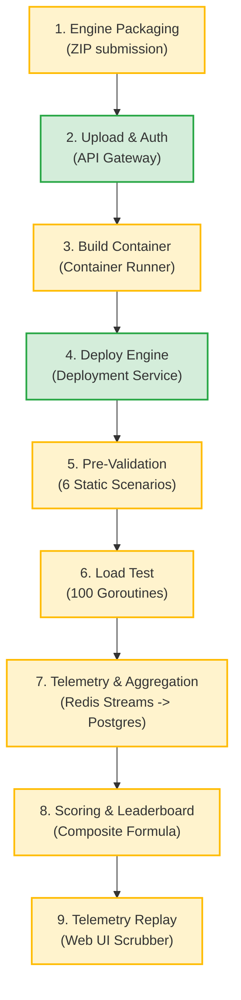

# BenchForge Phase 5 — Product Reality & Technical Readiness

**Audit Date:** 2026-10-17  
**Scope:** Verification of actual end-to-end user workflows, component maturity, operational burdens, and deployment capabilities.  
**Auditor:** Independent Product Strategist & Developer-Tools Market Researcher (Phase 5)

---

## 1. Executive Summary: What BenchForge Actually Does Today

BenchForge is designed as a specialized evaluation platform for automated trading engine benchmarking. It presents itself as a turnkey distributed harness comprising 9 Go microservices, Redis Streams, PostgreSQL, and a React/Vite web UI.

### The Objective Reality:
- **Demonstrable Workflow**: When supplied with trusted, pre-built binaries (such as `sample-engines/go-engine`) in a controlled single-user environment, BenchForge can run a pre-validation test suite, execute a deterministic HTTP load test, capture telemetry into Redis, compute a leaderboard score, and update a web UI.
- **Production Readiness**: **Zero.** In its current state, BenchForge cannot be deployed to public or multi-tenant users. A combination of compilation errors, missing database migration orchestration, root Docker-socket exposure, trivial directory traversal, and unauthenticated internal ports makes public deployment immediately disastrous.
- **Measurement Trustworthiness**: **Critically Compromised.** BenchForge cannot distinguish a real matching engine from an empty 200 OK HTTP stub, truncates sub-millisecond latencies to `0.0 ms`, and fakes its visual replay throughput via hardcoded math.

---

## 2. End-to-End User Journey Analysis

We evaluated the complete 9-step user journey, from initial landing to final score verification:

### Detailed Stage Breakdown:

| Step | User Action | Intended System Reaction | Actual Technical Reality | Failure / Distortion Mode | Confidence |
| :--- | :--- | :--- | :--- | :--- | :---: |
| **1. Packaging** | User zips Go/Rust/C++ source code. | Unpacked and built in Docker sandbox. | `unzip()` does not validate path prefixes (BF-P1-002, BF-P3-004). | Malicious ZIP achieves root host escape via Zip-Slip into Docker socket. | **High (Verified)** |
| **2. Submission** | User calls `POST /submissions`. | Authenticated via JWT; stored in DB. | Gateway validates JWT HMAC; routes to submission-service. | Syntax errors in `submissions.go:82-89` break compilation unless pre-patched (BF-P1-011). | **High (Verified)** |
| **3. Container Build** | System creates Docker image. | Builds isolated binary in container. | Docker daemon mounts host `/var/run/docker.sock` as root (BF-P1-004). Dockerfiles use non-existent Go 1.26 (BF-P1-022). | Container escape = full root host control. Fresh build fails on base image pull. | **High (Verified)** |
| **4. Engine Deployment** | System deploys container to dynamic port. | Isolated container on dedicated network. | Container is attached to `iicpc_benchforge_default` alongside Postgres and Redis (BF-P1-024). | Untrusted submission can directly execute raw SQL on Postgres or flush Redis. | **High (Verified)** |
| **5. Pre-Validation** | System tests engine correctness. | 6 trading scenarios assert matching behavior. | Scenarios are 100% static and deterministic (BF-P2-002). | A dummy engine with hardcoded `if symbol == 'AAPL'` passes validation with 100%. | **High (Verified)** |
| **6. Load Testing** | System bombards `/order` endpoint. | 100 goroutines generate 10,000–20,000 TPS. | Capped at ~1,200 ops/s by DB writes (BF-P4-003). Sockets leak on every request (BF-P4-002). | 95% of load uses `checkCorrectnessStub`, treating any HTTP 200 as correct (BF-P2-001). | **High (Verified)** |
| **7. Telemetry** | Events streamed to Redis and persisted. | Live WebSocket streaming and DB audit log. | Telemetry consumer writes 1 row per query (BF-P1-027). Latency is in nanoseconds (BF-P2-003). | Massive queue drainage lag (up to 90s); dashboard shows nanoseconds instead of ms. | **High (Verified)** |
| **8. Scoring** | Engine ranked on Leaderboard. | Monotonic composite ranking formula. | Duration truncated to integer seconds (BF-P2-004). Zero tracers gives 100% concurrency (BF-P2-007). | Cheater engine scores 14,885 vs 1,915 for real engine (7.7x cheater advantage). | **High (Verified)** |
| **9. Replay** | User inspects performance curves. | High-fidelity timeline replay scrubber. | Replay TPS is hardcoded as `count * 2` (BF-P2-005). Timestamps are duplicates (BF-P2-006). | Curves are mathematically fabricated; sub-500µs latencies read 0.0 ms (BF-P4-001). | **High (Verified)** |

---

## 3. Product Capability Matrix

| Feature / Subsystem | Claimed Capability | Actual Implementation Status | Empirical Evidence | True User Value | Current Limitations | Confidence |
| :--- | :--- | :--- | :--- | :--- | :--- | :---: |
| **Automated Build & Ingestion** | Turnkey compilation of Go, Rust, C++ engines. | **Partially Implemented / Broken** | Dockerfiles use non-existent `golang:1.26`; Zip traversal vulnerability in `runner.go`. | High (if working) | Fails clean deployment; enables complete host compromise. | **High** |
| **Correctness Oracle** | Validates Price-Time Priority and FIFO matching invariants. | **Partially Implemented (Pre-validation only)** | `executor_test.go` validates assertions; but load testing uses `checkCorrectnessStub` (BF-P2-001). | High | Cheaters bypass verification completely under load. | **High** |
| **Deterministic Workloads** | Multi-persona trading traffic (Whale, Retail, MM). | **Implemented** | `pool.go:25-51` generates reproducible 60/20/10/5/5 distribution mix. | Medium-High | Only limit orders generated; cancels and market orders absent (BF-P2-008). | **High** |
| **Throughput Generation** | 100,000 TPS load generation. | **Failed / Fabricated Claim** | Sustained capacity capped at ~1,200 req/s by single-row DB inserts (BF-P4-003). | Low | 99% below marketing claims; inferior to k6 or wrk. | **High** |
| **Tail-Latency Measurement** | Microsecond-accurate P50, P90, P99 tracking. | **Failed** | Latencies <500µs truncate to 0.0 ms due to integer rounding (BF-P4-001). | Zero | Cannot evaluate or rank modern low-latency matching engines. | **High** |
| **Live WebSocket Streaming** | Real-time monitoring of active benchmark run. | **Implemented with Defects** | `hub.go` streams Redis metrics, but has a concurrent map panic under `RLock()` (BF-P3-006). | High | Prone to crashing mid-benchmark upon client disconnect. | **High** |
| **Interactive Replay Scrubber** | 20-bucket time-series post-mortem replay. | **Partially Implemented / Corrupted Data** | Replay query works, but TPS is hardcoded as `count * 2` (BF-P2-005). | Low-Medium | Provides visual appeal, but displayed performance numbers are fake. | **High** |
| **Multi-Tenant Leaderboard** | Real-time contest rankings with personal bests. | **Implemented with Vulnerabilities** | `ON CONFLICT` upsert works, but cheaters dominate leaderboard; submissions lack IDOR checks. | Zero (as competition) | Any student or contestant can spoof rank or steal code. | **High** |
| **Multi-Job Concurrency** | Parallel evaluation of multiple teams. | **Failed / Serialized** | Hardcoded `if count >= 1 { return }` in `benchmarks.go:106`. | Low | Only 1 benchmark can run globally; maximum ~120 runs/hour. | **High** |

---

## 4. Setup, Infrastructure, and Operational Reality

Operating BenchForge today requires substantial manual intervention and developer expertise:

1. **Infrastructure Footprint**:
   - Requires Docker host running 9 distinct microservices, PostgreSQL 15, Redis 7, Prometheus, and Grafana.
   - Requires mounting host `/var/run/docker.sock` into containers with root privileges.
2. **Missing Automation**:
   - No migration runner exists; 33 raw SQL migration files across 5 directories must be applied manually or via scratch scripts before startup (BF-P1-023).
   - `scripts/` directory is completely empty (BF-P1-021).
   - Dockerfiles require manual editing to downgrade `golang:1.26` to `golang:1.22` (BF-P1-022).
3. **Manual Operation & Fragility**:
   - If an operator clicks "Cancel" on a benchmark, the queue starves permanently; an operator must restart `benchmark-service` to restore processing (BF-P3-003).
   - A single client closing their browser can trigger a fatal Go runtime map panic in `telemetry-service`, dropping all telemetry streams (BF-P3-006).
4. **Security Isolation Classification**:
   - **Trusted Local Demo**: **Passable** (if developer manually runs migrations, patches Dockerfiles, and submits known sample code).
   - **Controlled Internal Pilot**: **High Risk** (any accidental coding error or infinite loop locks the entire machine).
   - **Public / Multi-Tenant Service**: **Completely Blocked** (host takeover, data exfiltration, and database destruction are trivially achievable).
