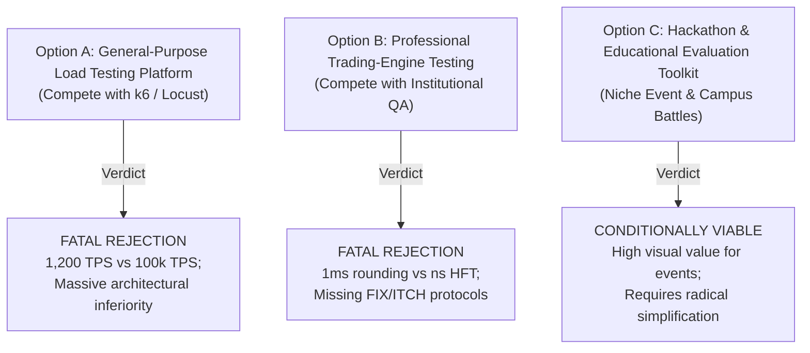

# BenchForge Phase 5 — Value Proposition & Product Scope Evaluation

**Audit Date:** 2026-10-17  
**Scope:** Formal value proposition formulation, evaluation of three candidate product scopes, and scoping recommendations.  
**Auditor:** Independent Technical Founder & Product Strategist (Phase 5)

---

## 1. Formal Value Proposition

### Candidate Value Proposition:
> **“For trading hackathon and collegiate competition organizers, BenchForge helps automate the evaluation and live spectator ranking of student-built matching engines by providing an integrated build-to-leaderboard pipeline with pre-configured trading scenarios and real-time visual telemetry, unlike custom grading scripts, which lack real-time visual engagement, automated scenario validation, and turnkey leaderboard management.”**

### Truth & Status Classification:
- **Target User**: *Trading competition organizers* — **Hypothesis** (unvalidated willingness to adopt).
- **Core Job**: *Automate evaluation and live ranking* — **Partially Verified** (demonstrated in lab, blocked by security and serialization).
- **Distinctive Mechanism**: *Integrated pipeline + visual telemetry* — **Observed Reality** (functional in local demo).
- **Current Alternative Limitation**: *Custom scripts lack visual excitement* — **Verified Fact** (textual logs vs. live WebSockets).
- **Caveat**: Claims of "trustworthy ranking" and "fair scoring" remain **Hypotheses / Contradicted by Findings** until anti-cheat exploits (BF-P2-001) and host escape vulnerabilities (BF-P3-004) are fully resolved.

---

## 2. Evaluation of Three Candidate Product Scopes

---

### Option A — General-Purpose Benchmarking Platform
*Attempting to market BenchForge as a competitor to k6, Gatling, Locust, or JMeter.*

- **User Pain & Evidence**: General engineering teams need fast, scalable, scriptable load generation.
- **Differentiation**: Virtually none. BenchForge requires writing Go code for custom scenarios, whereas k6 uses JavaScript/TypeScript and Locust uses Python.
- **Technical Feasibility**: **Impossible.** BenchForge sustains ~1,200 req/s due to unbatched database inserts (BF-P4-003) and leaks TCP sockets on every request (BF-P4-002). k6 routinely generates 50,000–100,000 req/s from a single binary.
- **Security & Trust Requirements**: Requires high enterprise trust, SOC2, secure multi-tenancy.
- **Development Effort**: Prohibitive (multi-year effort to match k6's protocol support and ecosystem).
- **Infrastructure Burden**: Extremely high (9 microservices, PostgreSQL, Redis, Prometheus, Grafana).
- **Adoption Friction**: Fatal (nobody will install 9 microservices to do what `k6 run script.js` does in 3 seconds).
- **Falsifiable Invalidation Assumption**: *"A developer will choose to deploy a 9-microservice cluster to test their REST API instead of downloading a single-binary load generator."* — **PROVEN FALSE.**
- **Verdict**: **CATEGORICALLY REJECTED.**

---

### Option B — Trading-Engine & Matching-Engine Evaluation
*Targeting professional prop trading shops, crypto exchanges, and fintech matching engine developers.*

- **User Pain & Evidence**: Exchanges need continuous performance and correctness regression testing.
- **Differentiation**: Domain-specific trading personas (Whale, Retail, Market Maker) and FIFO price-time priority validation.
- **Technical Feasibility**: **Failed.** Institutional matching engines measure latency in nanoseconds. BenchForge rounds sub-500µs to `0.0 ms` (BF-P4-001), suffers from a 1,000,000x unit discrepancy (BF-P2-003), and injects an arbitrary 5,000ms failure penalty that corrupts tail distributions (BF-P4-008). Furthermore, professional engines do not use REST HTTP; they require FIX, ITCH, or native memory drivers.
- **Security & Trust Requirements**: Extreme. Financial exchanges will never mount root Docker sockets or run untrusted code on shared infrastructure.
- **Development Effort**: High (requires rewriting the engine driver to support binary protocols, kernel bypass, and nanosecond HdrHistograms).
- **Infrastructure Burden**: Unjustified for the low performance delivered.
- **Adoption Friction**: Fatal (incompatible with professional exchange architecture).
- **Falsifiable Invalidation Assumption**: *"Institutional trading developers will evaluate low-latency matching engines over an HTTP REST wrapper that quantizes latencies to integer milliseconds."* — **PROVEN FALSE.**
- **Verdict**: **CATEGORICALLY REJECTED.**

---

### Option C — Hackathon & Educational Evaluation Toolkit
*A specialized platform for university hackathons, trading clubs, and corporate recruiting challenges.*

- **User Pain & Evidence**: Organizers want to host exciting "algo-trading battles" or "matching-engine showdowns" but lack the tools to ingest student code, grade correctness, and display a live animated leaderboard during the event.
- **Differentiation**: Turnkey ZIP-to-leaderboard pipeline, built-in trading personas, live WebSocket telemetry, and an interactive 20-bucket replay scrubber.
- **Technical Feasibility**: **Feasible with Remediation.** In a student contest, 1ms latency resolution and ~1,000 req/s throughput are acceptable. However, it currently fails due to the root Docker escape (BF-P3-004), cheater exploits (BF-P2-001), and single-benchmark serialization (BF-P4-006).
- **Security & Trust Requirements**: High (must prevent students from hacking the grading server or spying on peers' code via IDOR).
- **Initial Development Effort**: Moderate (remedying security, anti-cheat, and queue serialization).
- **Infrastructure & Maintenance Burden**: Currently too high (9 microservices are overkill for a student hackathon; needs simplification into a modular monolith or lightweight Compose setup).
- **Adoption Friction**: Moderate (organizers will adopt if setup takes under 10 minutes).
- **Falsifiable Invalidation Assumption**: *"Hackathon organizers are willing to deploy and maintain a multi-service Docker Compose infrastructure rather than using GitHub Classroom with a simple grading script."* — **CURRENTLY UNPROVEN / HIGH RISK.**
- **Verdict**: **THE ONLY CANDIDATE SCOPE WITH PLAUSIBLE VALUE.**

---

## 3. Scope Comparison Summary

| Metric / Dimension | Option A: General Load Testing | Option B: Professional HFT Testing | Option C: Hackathon & Education Toolkit |
| :--- | :---: | :---: | :---: |
| **Market Attractiveness** | Huge ($1B+) | Medium ($50M+) | Niche / Non-Commercial ($1M–$5M) |
| **BenchForge Competitive Strength** | Extremely Weak (0/10) | Severely Flawed (1/10) | Strong Visual Fit (7/10) |
| **Technical Alignment** | Negative (1,200 TPS cap) | Fatal (1ms integer rounding) | Acceptable (ms scale fits students) |
| **Feasibility of Remediation** | Impossible | Prohibitive | Moderate (4–6 weeks engineering) |
| **Commercial Startup Viability** | Zero | Zero | Very Low (Event sponsorship only) |
| **Engineering Portfolio Value** | Low (Worse k6) | Low (Failed HFT claims) | **Outstanding (Showcase platform)** |

---

## 4. Recommended Scope Direction

BenchForge must **abandon all aspirations of competing as a general-purpose load tester or institutional HFT benchmark.**

If pursued further, BenchForge must be explicitly scoped as **Option C: A Turnkey Trading Hackathon & Educational Evaluation Platform**. 

However, because the commercial market for trading hackathons is small and seasonal (mostly universities and recruiting firms), this scope **does not justify venture-backed startup investment**. Instead, it represents the ideal definition for a **top-tier open-source engineering project and portfolio showcase**.
