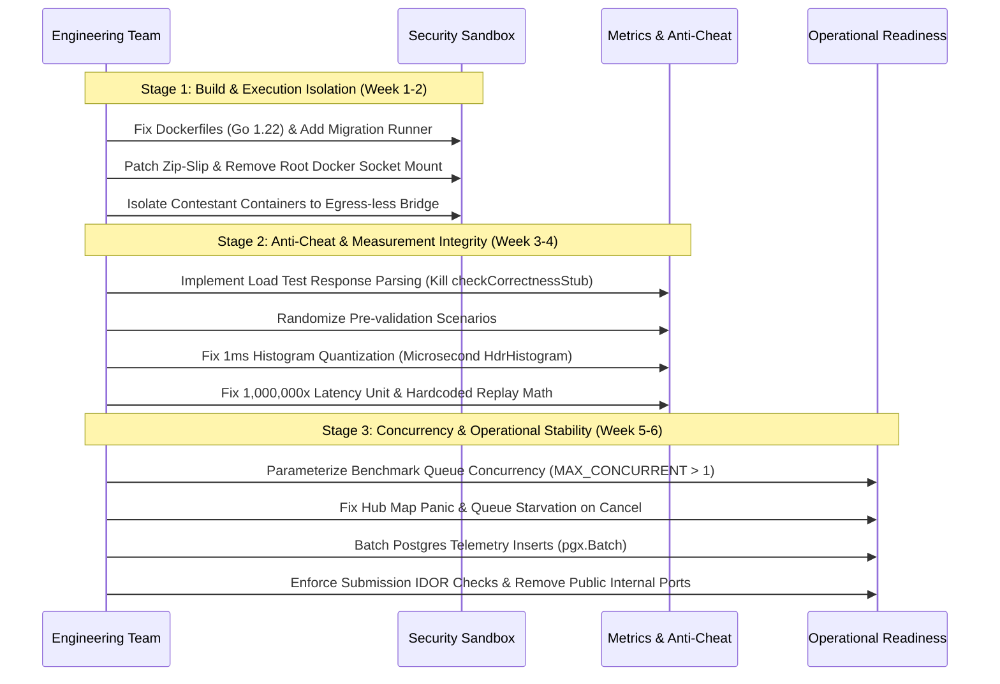

# BenchForge Phase 5 — Product Readiness & Trust Blockers

**Audit Date:** 2026-10-17  
**Scope:** Prioritization of critical technical, security, and integrity blockers preventing credible demo, pilot, or multi-tenant deployment.  
**Auditor:** Independent Technical Systems & Security Auditor (Phase 5)

---

## 1. Trust & Deployment Classification

To establish absolute clarity for operators and users, BenchForge's deployment viability is categorized into three strict operating tiers:

```
┌────────────────────────────────────────────────────────────────────────────────────────┐
│                              DEPLOYMENT TRUST GATE                                     │
├────────────────────────────────────────────────────────────────────────────────────────┤
│  Tier 1: Controlled Local Demo (Trusted Developer & Sample Code)     → CONDITIONALLY PASS│
│  Tier 2: Private Academic Pilot (Known Students / Supervised Event)   → BLOCKED (UNSAFE) │
│  Tier 3: Public / Multi-Tenant Service (Untrusted Third-Party Code)   → FATALLY BLOCKED  │
└────────────────────────────────────────────────────────────────────────────────────────┘
```

> [!CAUTION]
> **MANDATORY POLICY ENFORCEMENT:**  
> Under no circumstances should BenchForge accept untrusted third-party code or be exposed to an open network until all Tier 2 and Tier 3 blockers are formally closed and verified by automated regression test suites.

---

## 2. Prioritized Product Readiness Blockers

The matrix below maps technical defects directly to real-world user consequences, minimum remediation steps, and verification requirements:

| Finding ID | Technical Defect / Vulnerability | Real-World User / Operator Consequence | Severity | Blocks Which Tier? | Minimum Acceptable Remediation | Verification Evidence Required |
| :--- | :--- | :--- | :---: | :---: | :--- | :--- |
| **BF-P3-004** | Docker socket mounted in root container + Zip path traversal. | Contestant archive achieves root host escape, wipes host disk, or installs backdoors. | 🔴 CRITICAL | **Tier 2 & 3** (All External) | 1. Implement strict path prefix validation in `unzip()`.<br>2. Run container-runner unprivileged or use rootless Podman / gVisor.<br>3. Remove Docker socket volume mount. | Automated regression test passing `../../` traversal attacks and verifying socket unreachability. |
| **BF-P1-024** | Contestant containers share `iicpc_benchforge_default` network. | Untrusted trading engine opens TCP connection to Postgres (5432) or Redis (6379), drops database, or tampers with scores. | 🔴 CRITICAL | **Tier 2 & 3** (All External) | Create an isolated internal Docker bridge (`contestant_sandbox`) with `internal: true` and no egress route to DB/Redis. | Network audit proving contestant container cannot ping or connect to Postgres/Redis ports. |
| **BF-P3-005** | Unauthenticated microservice ports (8081–8085, 8091) exposed on `0.0.0.0`. | Any user on the same WiFi / LAN / cloud VPC bypasses the API Gateway and calls internal APIs (e.g. trigger container builds or modify scores). | 🔴 CRITICAL | **Tier 2 & 3** (All External) | Remove public `ports:` declarations in `docker-compose.yml` for all downstream services; route strictly via internal Docker network aliases. | Port scan from external IP verifying only API Gateway (8080) and Frontend (3000) are open. |
| **BF-P2-001** | Load test correctness validation is a 200 OK stub (`checkCorrectnessStub`). | A cheating contestant returning empty HTTP 200 responses beats honest trading engines by 7.7x on the leaderboard. | 🔴 CRITICAL | **Tier 2 & 3** (All Competitions) | 1. Parse and assert order execution receipts and trade arrays during load testing.<br>2. Remove fallback to `computedSuccessRate` in `leaderboard.go`. | Re-run adversarial engine test proving dummy 200 OK engine receives a 0.0 correctness score. |
| **BF-P2-002** | Static, deterministic pre-validation scenarios (fixed prices/symbols). | Contestants pass 100% of validation tests with hardcoded `if symbol == "AAPL"` receipts without building an order book. | 🔴 CRITICAL | **Tier 2 & 3** (All Competitions) | Dynamically randomize order symbols, IDs, quantities, and price offsets per benchmark session using a cryptographic seed. | Adversarial test proving static hardcoded response engines fail randomized validation. |
| **BF-P3-002** | Insecure Direct Object Reference (IDOR) on `/submissions/:id` and logs. | Any contestant can view competitors' proprietary code build logs, scenario validation receipts, and container images. | 🔴 CRITICAL | **Tier 2 & 3** (All Competitions) | Enforce ownership check in `submission-service`: verify caller's `TeamID` matches submission owner or caller is `ADMIN`. | Integration test proving Team B receives HTTP 403 when requesting Team A's submission details or log stream. |
| **BF-P4-006** | Global execution serialization (`MAX_CONCURRENT_BENCHMARKS = 1`). | In an event with 50 teams submitting before a deadline, submissions queue serially. The 50th team waits over 25 minutes for results. | 🟠 HIGH | **Tier 2 & 3** (Event Usability) | Parameterize concurrency limit; implement worker pool queue dispatch supporting $N$ concurrent benchmark executions. | Automated load test executing 5 parallel benchmarks concurrently without deadlock or queue stalls. |
| **BF-P3-003** | Queue starvation on manual cancellation (`StopBenchmark`). | If an admin cancels a stuck benchmark in the UI, the platform permanently stops processing the queue until service reboot. | 🟠 HIGH | **Tier 1, 2 & 3** (All Tiers) | Add `go h.ProcessQueue()` immediately following status update to `CANCELLED` in `benchmarks.go:155`. | Unit test proving cancelling a running job causes queued jobs to immediately start executing. |
| **BF-P4-001** | Integer millisecond histogram quantization truncates <500µs to 0.0 ms. | High-performance C++ or Rust engines running sub-millisecond execution times all report identical 0.0ms P50/P99 latency. | 🟠 HIGH | **Tier 1, 2 & 3** (Metric Credibility) | Replace `math.Round(ms)` in `percentiles.go` with microsecond-level HdrHistogram or logarithmic quantile tracking. | Unit test verifying 150µs and 450µs latencies report as 0.15ms and 0.45ms, not 0.0ms. |
| **BF-P2-003** | 1,000,000x latency unit mismatch across microservices (ns vs ms). | WebSocket live view and Replay scrubbers display latencies in nanoseconds (e.g. 15,000,000) while summaries show 15.0ms. | 🟠 HIGH | **Tier 1, 2 & 3** (UI Credibility) | Standardize all services on integer microseconds (`µs`) or floating-point milliseconds (`ms`) at the point of metric creation. | Integration test verifying Replay P99 matches Leaderboard P99 within 1% margin. |
| **BF-P2-005** | Replay bucket throughput calculated as hardcoded `count * 2`. | Replay scrubber graphs fabricated throughput curves that diverge from actual performance by up to 20x. | 🟠 HIGH | **Tier 1, 2 & 3** (UI Credibility) | Calculate bucket duration from `max(created_at) - min(created_at)` and compute real `float64(count) / duration`. | Automated test proving Replay bucket TPS matches empirical orders-per-second within 5%. |
| **BF-P1-022** | All 9 Dockerfiles reference non-existent base image `golang:1.26-alpine`. | `docker compose build` fails out of the box on a clean developer checkout; fresh installation impossible without manual edit. | 🔴 CRITICAL | **Tier 1, 2 & 3** (Initial Setup) | Update all Dockerfiles to use current stable Go release (e.g. `golang:1.22-alpine` or `golang:1.23-alpine`). | Successful end-to-end execution of `docker compose build` on a clean host. |
| **BF-P1-023** | No database migration runner; 33 SQL files never executed on boot. | Platform crashes on first API call with "relation does not exist" errors unless developer manually executes SQL scripts. | 🔴 CRITICAL | **Tier 1, 2 & 3** (Initial Setup) | Add an automated migration init container or integrate `golang-migrate` into service boot sequences. | Successful `docker compose up` on a fresh volume resulting in all 14 tables correctly created. |
| **BF-P3-006** | Concurrent map write panic under `RLock()` in WebSocket Hub. | A contestant closing their browser tab panics the `telemetry-service`, dropping all active WebSocket connections across the event. | 🟠 HIGH | **Tier 1, 2 & 3** (Operational Stability)| Upgrade `h.mu.RLock()` to exclusive `h.mu.Lock()` in `hub.go:62` when deleting clients from room maps. | Concurrency stress test disconnecting 50 WebSocket clients simultaneously without runtime panic. |

---

## 3. Trust Architecture Remediation Plan

To advance BenchForge from an unstable lab prototype to a credible educational hackathon evaluator, the remediation must follow a strict 3-stage sequence:



### Strategic Recommendation:
Do not recruit pilot users, advertise competitions, or seek funding until Stages 1 and 2 are 100% completed and verified.
