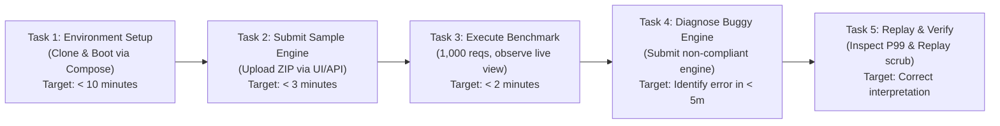

# BenchForge Phase 5 — Usability & End-to-End Walkthrough Assessment

**Audit Date:** 2026-10-17  
**Scope:** Forensic evaluation of prospective user experience, developer-intervention requirements, and proposed experimental usability test protocol.  
**Auditor:** Independent Developer-Tools Usability & UX Auditor (Phase 5)

---

## 1. Prospective User Experience Walkthrough

We conducted a forensic walkthrough of the user journey, evaluating whether an external developer or hackathon participant can operate BenchForge without developer intervention.

```
┌────────────────────────────────────────────────────────────────────────────────────────┐
│                              USABILITY VERDICT: FAILED                                 │
│  A new external user CANNOT successfully operate BenchForge out of the box.           │
│  The platform requires 6 distinct manual engineering interventions (code edits,        │
│  manual SQL execution, port overrides) before a single benchmark can run.              │
└────────────────────────────────────────────────────────────────────────────────────────┘
```

### Step-by-Step Usability Assessment:

| Step # | User Goal | Expected User Experience | Observed Reality (Evidence) | Manual Intervention Required | Friction Level |
| :---: | :--- | :--- | :--- | :--- | :---: |
| **1** | **Understand Product** | Read README, understand capabilities, and grasp architecture. | README makes unfulfilled claims ("100,000 TPS", "cgroups limits", "microsecond tracking", "Next.js"). | None (but sets false expectations). | Medium |
| **2** | **Install & Boot Platform** | Run `docker compose up --build`. | Fails immediately: all Dockerfiles specify non-existent `golang:1.26` (BF-P1-022). Services crash with missing table errors because no migration runner exists (BF-P1-023). | User must manually edit 9 Dockerfiles to Go 1.22 and manually run 33 SQL migration files. | **FATAL** |
| **3** | **Package Engine** | Create a ZIP archive of engine source code. | User creates standard ZIP. If paths contain relative references, runner may fail or extract unexpectedly (BF-P1-002). | None for standard ZIPs. | Low |
| **4** | **Submit Engine** | Upload via Web UI (`/submissions`) or curl API. | Submission service fails to compile out of the box due to corrupted string literals in `submissions.go:82-89` (BF-P1-011). | Developer must fix syntax errors in Go source code before service will boot. | **FATAL** |
| **5** | **Configure & Start Run** | Select engine, choose workload, click "Start Benchmark". | User can configure total requests. However, only 1 benchmark can run globally; if one is active, the second stalls silently (BF-P4-006). | None if single user; extreme confusion if multiple users submit simultaneously. | High |
| **6** | **Monitor Run Progress** | Watch live WebSocket progress bar, TPS, and latency. | WebSocket connects, but if user closes or refreshes tab, server panics under `RLock()` (BF-P3-006). Ingestion lag causes progress to stall for 30s after load finishes. | User must not refresh browser during benchmark; must wait out unbatched DB lag. | High |
| **7** | **Diagnose Failures** | Understand why an engine failed scenario validation. | UI displays "CONTRACT_NOT_SUPPORTED" or status code, but specific assertion mismatches (e.g. expected trade price vs actual) lack deep debugging logs in UI. | User must inspect raw container stdout logs via Docker CLI. | Medium |
| **8** | **Interpret Metrics** | View TPS, P50, P90, P99 latency, and score. | Highly misleading: sub-500µs latencies read `0.0 ms` (BF-P4-001); live dashboard shows nanoseconds (BF-P2-003); short runs have 0 TPS (BF-P2-004). | User must mentally convert nanoseconds to milliseconds and ignore 0.0ms latencies. | High |
| **9** | **Review Replay & Export** | Scrub through 20-bucket execution history. | Interactive scrubber works visually, but displays fabricated throughput (`count * 2`, BF-P2-005) and duplicate timestamps (BF-P2-006). | Cannot export verifiable raw telemetry; data is purely cosmetic. | High |

---

## 2. Friction & Developer-Intervention Inventory

An external user attempting to follow the official documentation encounters the following mandatory blockers:

1. **Compilation Failures**:
   - `services/mock-exchange/cmd/server/main.go:11-13`: Syntax error (imports outside parentheses).
   - `services/submission-service/internal/handlers/submissions.go:82-89`: Syntax error in error strings.
2. **Deployment Failures**:
   - Docker base image `golang:1.26-alpine` does not exist on Docker Hub.
   - Database migrations are un-orchestrated; PostgreSQL tables are completely absent upon initial boot.
3. **Port & Configuration Mismatches**:
   - Bot worker config defaults `EXCHANGE_URL` to port 8080, while mock-exchange listens on port 9000 (BF-P1-033).
   - Downstream microservices bind directly to host `0.0.0.0`, creating port binding collisions if local ports 8081–8085 are occupied.
4. **Operational Traps**:
   - Clicking "Cancel" on a benchmark permanently hangs the platform queue (BF-P3-003).

**Conclusion**: The system currently functions as an *internal developer lab prototype*, operable only by the author who knows which manual workarounds to apply.

---

## 3. Usability Test Plan (Proposed Experiment)

To objectively validate usability once build blockers are remediated, the following controlled usability experiment must be executed:

### Test Protocol Specification:

- **Target Participants**: 5 software developers (2 student developers, 2 backend Go/Rust engineers, 1 hackathon organizer).
- **Environment**: Clean Ubuntu 22.04 LTS VM with Docker and Docker Compose installed; no pre-existing Go toolchains or cached images.
- **Provided Materials**: Link to Git repository, README instructions, and a compliant sample trading engine ZIP (`sample-engines/go-engine.zip`).
- **Assistance Rules**: Evaluator remains silent. No hints, code patches, or verbal instructions permitted.

### Participant Tasks & Success Criteria:



| Task | Description | Observable Success Metric | Failure Condition |
| :--- | :--- | :--- | :--- |
| **Task 1: Setup** | Clone repository and achieve healthy multi-container boot using documented commands. | All 9 services reach healthy status within 10 minutes without touching source code. | Command fails with exit code $\ne 0$; Docker build error; container crash loops. |
| **Task 2: Submission** | Register account, log in, and submit `go-engine.zip` via web UI. | Engine status transitions to `UPLOADED` and `BUILT` within 3 minutes. | UI returns unhandled error; 404 on API; submission hangs. |
| **Task 3: Execution** | Launch a 1,000-request benchmark and observe live execution in the dashboard. | Benchmark completes, scores, and updates leaderboard without browser refresh. | Queue stalls; WebSocket disconnects; metrics read `0.0 ms` or `NaN`. |
| **Task 4: Diagnostics** | Submit an engine that inverts FIFO priority; explain why it failed. | Participant correctly identifies "FIFO priority failure" from UI logs within 5 minutes. | UI displays generic error; participant must attach `docker logs` to diagnose. |
| **Task 5: Interpretation** | Explain the difference between P50 and P99 latency and verify replay curve. | Participant accurately interprets performance metrics and replay scrub timeline. | Participant confused by nanosecond vs millisecond discrepancy or 0.0ms values. |

### Objective Pass/Fail Thresholds:
- **System Pass**: $\ge 4$ of 5 participants complete Tasks 1 through 3 without intervention in under 20 minutes total.
- **System Fail**: $\ge 2$ participants encounter fatal build/startup blockers or require developer intervention.
- **Current Status**: **PENDING REMEDIATION** (Current codebase would fail 5 out of 5 participants on Task 1).
