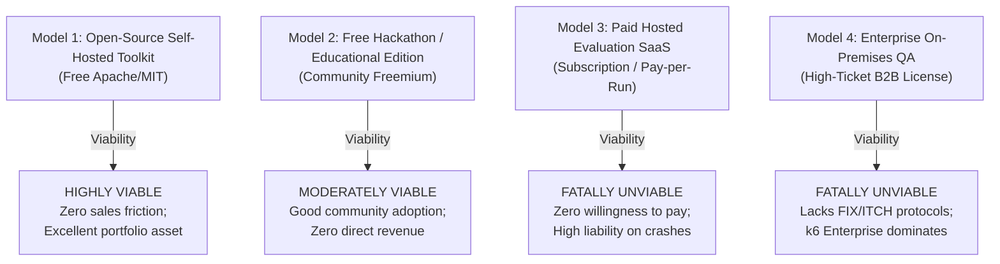

# BenchForge Phase 5 — Operating Economics & Business Model Analysis

**Audit Date:** 2026-10-17  
**Scope:** Bottom-up infrastructure cost modeling, operational maintenance burdens, business model viability, and customer willingness to pay.  
**Auditor:** Skeptical Technical Founder & Financial Analyst (Phase 5)

---

## 1. Known Cost Drivers & Operational Burdens

BenchForge's architecture is unusually heavy for an evaluation tool: 9 microservices, PostgreSQL, Redis, Prometheus, Grafana, and nested Docker-in-Docker runner containers.

### Core Resource Drivers:
1. **Container Infrastructure**:
   - 9 Go microservice containers running continuously.
   - Dedicated PostgreSQL 15 database instance with persistent disk storage.
   - Dedicated Redis 7 instance holding streaming buffers and persona indexes.
   - Prometheus and Grafana monitoring stack.
   - Ephemeral contestant engine containers deployed dynamically.
2. **Memory Footprint**:
   - Base idle footprint across the 12 core containers: **~1.8 GB RAM**.
   - Under active benchmark load (1,000 req/s, 100 worker goroutines, channel buffers): **3.5 GB – 6.0 GB RAM**.
   - If a contestant requests 5,000,000 orders without channel bounds (BF-P4-004): worker container heap spikes by **+725 MB RAM**, risking OOM crashes.
3. **Database Write & Storage Accumulation**:
   - Every benchmark request writes a telemetry metric into PostgreSQL.
   - At 152 bytes per metric row plus index overhead: **~120 MB disk per 1,000,000 orders**.
   - An event with 100 benchmarks of 100,000 orders accumulates **~12 GB of uncompressed telemetry rows**.
4. **Maintenance & DevOps Overhead**:
   - Maintaining 9 Dockerfiles, cross-service network bridges, Docker socket proxies, Redis Stream consumers, dead-letter queues, and database schemas requires ongoing DevOps engineering time.

---

## 2. Infrastructure Hosting Cost Model

We model hosting costs across major cloud providers (AWS, GCP, Hetzner) to determine the cost per benchmark run and cost per event.

### Deployment Profiles:

```
┌────────────────────────────────────────────────────────────────────────────────────────┐
│                                 HOSTING PROFILES                                       │
├────────────────────────────────────────────────────────────────────────────────────────┤
│  Profile A: Self-Hosted Cloud VM (e.g. AWS t3.xlarge / Hetzner CPX41)                  │
│             4 vCPUs, 16 GB RAM, 100 GB NVMe SSD                                        │
│             Cost: ~$15/month (Hetzner) to ~$120/month (AWS EC2 on-demand)              │
│                                                                                        │
│  Profile B: Managed Kubernetes Cluster (EKS / GKE)                                     │
│             Control plane + 2 worker nodes (t3.large, 2 vCPU, 8 GB RAM each)            │
│             Cost: ~$180 - $250/month                                                   │
└────────────────────────────────────────────────────────────────────────────────────────┘
```

### Measured Cost-Per-Run Estimates:

Given that `MAX_CONCURRENT_BENCHMARKS = 1` (BF-P4-006) and the average benchmark duration with warmup and drainage is **~30 seconds** (BF-P4-005):
- Maximum global throughput: **120 benchmarks / hour** (2,880 benchmarks / day).
- Storage per benchmark (10,000 requests): ~1.2 MB database storage + ~0.5 MB logs.

| Hosting Model | Fixed Monthly Cost | Variable Cost per 1,000 Benchmarks | Infrastructure Cost per Benchmark Run |
| :--- | :---: | :---: | :---: |
| **Hetzner Cloud (CPX41, 16GB RAM)** | $15.50 / mo | ~$0.15 (Disk/Bandwidth) | **$0.005 – $0.01** |
| **AWS EC2 (t3.xlarge + gp3 EBS)** | $122.40 / mo | ~$1.20 | **$0.04 – $0.08** |
| **AWS Managed EKS + RDS Postgres** | $285.00 / mo | ~$4.50 | **$0.12 – $0.25** |

**Economic Observation**: Cloud compute costs are *not* the fatal barrier. At $0.01 to $0.08 per benchmark, hosting is relatively inexpensive. **The true cost driver is engineering maintenance and operational support overhead.**

---

## 3. Comparative Business Model Analysis

We evaluate four potential delivery and monetization models:



### Detailed Model Evaluation:

| Dimension | Model 1: Open-Source Toolkit | Model 2: Free Educational / Hackathon | Model 3: Paid Hosted SaaS | Model 4: Enterprise On-Premises |
| :--- | :--- | :--- | :--- | :--- |
| **Target Customer** | Independent devs, student clubs. | University algorithmic trading clubs. | Hackathon organizers, boutique prop shops. | Commercial exchanges, fintech startups. |
| **Value Proposition** | Turnkey local trading engine evaluator. | Complete hackathon platform in a box. | Hosted competition platform with live leaderboards. | Automated compliance & performance QA platform. |
| **Who Pays?** | Nobody (Volunteer / Community). | Corporate event sponsors (Citadel, Optiver). | Event organizers or participating teams. | VP of Engineering / Head of QA. |
| **Willingness to Pay** | **$0** (Universal OSS expectation). | **$0 - $500** per event (from sponsor budget). | **$0 - $50** (Extreme reluctance to pay for hosting). | **$10,000 - $50,000 / year** (Hypothetical). |
| **Support Burden** | Low (Community GitHub issues). | Medium (During live weekend events). | High (SLA required; frantic support during contests). | Extreme (Custom integrations, security audits). |
| **Product Defensibility** | Low (Can be forked or scripted). | Moderate (Turnkey UI convenience). | Very Low (Competes with free GitHub Actions). | Zero (k6 / Gatling have 10+ years maturity). |
| **Current Readiness** | Needs Compose build cleanup. | Needs security & anti-cheat remediation. | Blocked by all Phase 3 & 4 vulnerabilities. | Blocked by architecture & missing protocols. |
| **Viability Verdict** | **RECOMMENDED (Optimal Model)** | **Secondary Community Channel** | **REJECTED (Commercial Dead End)** | **REJECTED (Severe Product-Market Mismatch)** |

---

## 4. Willingness-to-Pay Reality Check

### Finding: **Commercial Startup Demand is Virtually Non-Existent**

1. **Hackathon Organizers**: University clubs run on student union budgets ($500–$2,000 total per semester). They will not pay for software licenses when they can run scripts on GitHub Actions for free. Corporate sponsors (trading firms) provide prize money, but rarely fund third-party proprietary testing SaaS when they already have their own proprietary platforms.
2. **Independent Developers**: Zero willingness to pay; developers expect local benchmarking utilities to be free open-source tools (like `wrk`, `hyperfine`, or `criterion`).
3. **Fintech / Prop Desks**: Have budget, but will *never* buy BenchForge because it lacks FIX/ITCH protocol support, tops out at 1,200 req/s, and rounds latencies to 1ms. They already buy k6 Enterprise, Gatling Enterprise, or build in C++.

### Strategic Conclusion:
BenchForge **cannot support a venture-backed or bootstrap SaaS startup**. Attempting to monetize it as a paid product will result in protracted sales cycles with zero conversions. 

Its optimal economic expression is an **Open-Source Developer Showcase**, where the return on investment is realized as **engineering reputation, portfolio credibility, and career capital**.
