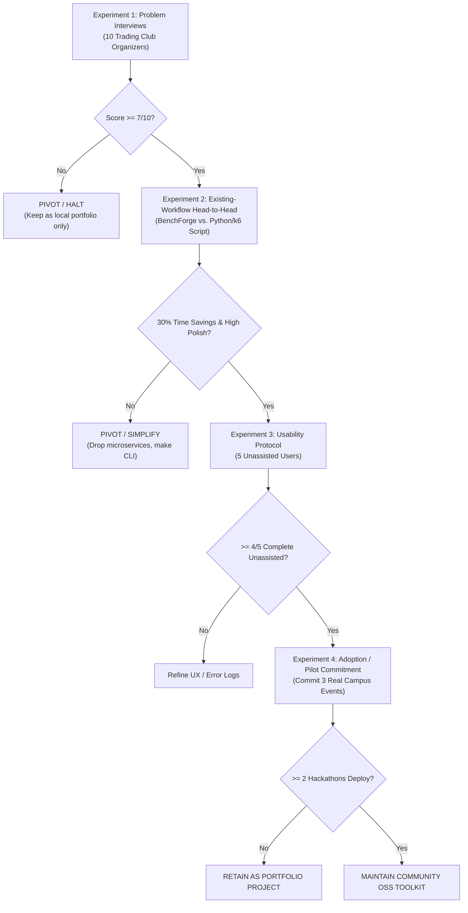

# BenchForge Phase 5 — Validation Experiments & Decision Protocol

**Audit Date:** 2026-10-17  
**Scope:** Design of 4 low-cost empirical validation experiments, objective pass/fail thresholds, and post-outcome decision rules.  
**Auditor:** Independent Technical Founder & Product Strategist (Phase 5)

---

## 1. Experimental Validation Protocol

Before making any substantial new software engineering investments (beyond foundational security and build fixes), the project must execute four low-cost empirical validation experiments to replace assumptions with verified data.

---

## 2. Detailed Experiment Specifications

### Experiment 1 — Problem Discovery Interviews (Targeting Organizers)

- **Hypothesis**: Trading club leaders and hackathon organizers spend $\ge 15$ hours manually grading trading engine submissions and consider the lack of a live, animated visual leaderboard a major pain point.
- **Target Participant Profile**: 10 organizers (officers of university algorithmic trading societies, collegiate hackathon leads, or campus recruiting coordinators at firms like Optiver, Jane Street, or IMC).
- **Recruitment Approach**: Direct outreach via LinkedIn, university trading club Discord servers, and GitHub issue discussions on open-source trading engines.
- **Methodology & Non-Biased Questions**:
  1. *"How do you currently evaluate student code submissions during your trading hackathons?"*
  2. *"What is the most frustrating, time-consuming, or fragile part of that workflow?"*
  3. *"How do you display results to participants during the event, and how do they react?"*
  4. *"Have you ever had students submit code that crashed the grading server or attempted to game the score? How did you handle it?"*
  5. *(Only at the end)*: Show a 60-second video of BenchForge's live WebSocket dashboard and replay scrubber: *"Would deploying this Docker Compose harness save you time or create more headaches compared to your current setup?"*
- **Cost & Effort**: ~$0 budget; 15 hours of interviewer time over 2 weeks.
- **Success Threshold**: At least 7 of 10 participants state that automated grading and real-time visualization are "critical unmet needs" and express desire to test a pilot.
- **Failure Threshold**: More than 4 participants state that simple GitHub Actions scripts are "good enough" or express strong reluctance to deploy a multi-service Docker container stack.
- **Decision Following Outcome**: If failed, abandon all multi-service event orchestration features; narrow focus strictly to a single-developer CLI.

---

### Experiment 2 — Head-to-Head Existing-Workflow Comparison

- **Hypothesis**: Setting up and running an evaluation on BenchForge reduces event setup time by at least 30% compared to authoring a custom Python + k6 evaluation script, while delivering superior visual diagnostic value.
- **Target Task**: Evaluate 3 candidate Go matching engines against a 5-step scenario suite and 1,000-request load test, calculating TPS, P99 latency, and FIFO correctness.
- **Methodology**:
  - Task A: Build a custom Python script using `requests` + `k6` to run scenarios and load test, outputting results to a terminal table.
  - Task B: Boot BenchForge (with build patches applied), submit the 3 engines, and review results on the web leaderboard and replay scrubber.
- **Measurements Recorded**:
  1. Total elapsed engineering time to first valid result.
  2. Operational complexity (number of commands, lines of configuration, host CPU/RAM consumed).
  3. Measurement accuracy (comparison of reported P99 vs true empirical latency).
  4. Participant qualitative rating of result trustworthiness and diagnostic clarity.
- **Success Threshold**: BenchForge delivers at least a 30% reduction in setup time for a complete multi-team contest while providing diagnostic clarity rated $\ge 8/10$.
- **Failure Threshold**: BenchForge requires more setup time, consumes $>4\times$ more RAM, or produces distorted latency metrics compared to the Python/k6 baseline.
- **Decision Following Outcome**: If failed, deprecate the 9-microservice architecture in favor of a single lightweight Go CLI tool wrapping an embedded engine harness.

---

### Experiment 3 — Prototype Usability & Diagnostic Test

- **Hypothesis**: An external software engineer can clone BenchForge, submit an engine, interpret a correctness failure, and review replay performance without any external developer intervention in under 20 minutes.
- **Target Participants**: 5 software developers (2 students, 2 Go backend engineers, 1 hackathon judge) who have never seen the codebase.
- **Methodology**: Execute the 5-task unassisted protocol specified in `audit/phase-5/08-usability-assessment.md` on a clean Linux VM. Evaluator observes quietly and logs all friction points.
- **Observable Measures**:
  - Task completion rate without verbal assistance.
  - Time-to-first-successful-benchmark.
  - Error diagnostic accuracy (can user explain why an engine failed scenario #3?).
- **Success Threshold**: $\ge 4$ of 5 participants complete all tasks successfully in $<20$ minutes total; zero fatal setup blockers.
- **Failure Threshold**: $\ge 2$ participants encounter fatal startup errors or misinterpret the latency/score output due to UI discrepancies.
- **Decision Following Outcome**: If failed, halt all new feature development; spend 1 sprint fixing error messages, UI units, and setup ergonomics.

---

### Experiment 4 — Real-World Pilot Demand & Adoption Test

- **Hypothesis**: University trading clubs or collegiate hackathons will agree to officially pilot BenchForge as their primary grading and leaderboard platform for an upcoming competition.
- **Target Participants**: 3 distinct collegiate hackathons or algorithmic trading student competitions.
- **Methodology**: Offer BenchForge as a free, fully supported evaluation platform for their next event. Provide pre-built Docker Compose manifests, documentation, and sample engine templates.
- **Required Commitment from Partner**:
  - Official agreement to use BenchForge for live grading during the event.
  - Minimum of 20 participating student teams submitting engines.
  - Post-event feedback surveys completed by organizers and students.
- **Success Threshold**: At least 2 competitions complete their live events using BenchForge with zero platform crashes, zero cheating exploits reported, and $\ge 80\%$ positive organizer satisfaction.
- **Failure Threshold**: Zero organizers agree to pilot the platform, or the platform crashes / starves during a live event.
- **Decision Following Outcome**:
  - If Successful: Formally maintain BenchForge as an active open-source hackathon platform.
  - If Failed: Transition BenchForge to an archived, highly documented engineering portfolio piece.

---

## 3. Experiment Status Summary Table

| Experiment | Focus Area | Cost / Effort | Target Sample | Success Metric | Current Status |
| :--- | :--- | :---: | :---: | :---: | :---: |
| **Exp 1: Problem Interviews** | Problem Validation | 15 hrs / $0 | 10 Organizers | 7/10 express strong unmet need | **Pending Execution** |
| **Exp 2: Workflow Comparison** | Differentiated Value | 8 hrs / $0 | 2 Toolchains | 30% time savings + high polish | **Pending Execution** |
| **Exp 3: Usability Protocol** | Product Ergonomics | 10 hrs / $0 | 5 Developers | 4/5 complete unassisted in <20m | **Blocked by Build Defects** |
| **Exp 4: Pilot Demand Test** | Real-World Adoption | 30 hrs / $0 | 3 Competitions | 2 events successfully completed | **Blocked by Security (P3)** |

### Mandatory Rule:
All experiments are currently **PENDING OR BLOCKED**. Do not claim user validation or customer demand until these experiments have been formally executed with real external participants.
